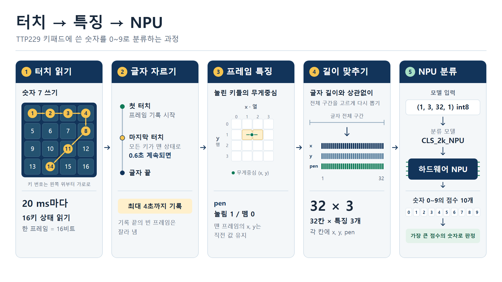
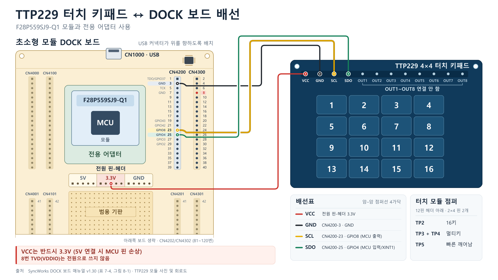
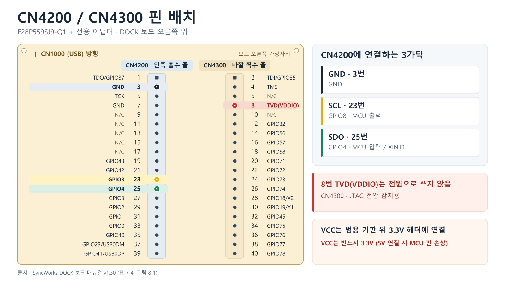

# 8_TouchDigitLogger — 터치 키패드에 쓴 숫자 수집기

TTP229 4x4 정전식 터치 키패드 위에 손가락으로 쓴 **글자 하나**를 기록해 Edge AI Studio 분류 학습용 CSV로 저장하는 예제입니다. 학습한 모델은 같은 저장소의 [`9_TouchDigitClassify_NPU`](../9_TouchDigitClassify_NPU/README.md)가 하드웨어 NPU로 실행합니다.

**3줄 요약**
- 키가 눌린 위치와 순서를 20ms마다 쌓은 뒤, 글자 하나를 **32칸 x 3열(x, y, pen)** 특징으로 바꿔 CSV 한 파일로 저장합니다.
- CCS Scripting Console의 `collect_touch.js`가 "숫자 N을 쓰세요"라고 안내하고, 숫자 0~9를 섞어 가며 저장합니다.
- DOCK 보드 + F28P559SJ9-Q1에서 실제로 300글자(숫자당 30)를 수집해 학습했고, 학습한 모델이 보드 채점 30/30을 냈습니다.

## 1. 전체 흐름

| 단계 | 프로젝트 | 하는 일 |
|---|---|---|
| ① 수집 | `8_TouchDigitLogger` (이 폴더) | 숫자를 써서 학습 데이터(CSV)를 모음 |
| ② 학습 | Edge AI Studio | 모은 데이터로 분류 모델을 학습·컴파일 |
| ③ 판정 | `9_TouchDigitClassify_NPU` | 학습한 모델을 NPU로 실행해 숫자를 판정하고 정답률 채점 |



## 2. 준비물

| 항목 | 내용 |
|---|---|
| 보드 | 초소형 모듈 DOCK 보드 + 전용 어댑터 + TMS320F28P559SJ9-Q1 모듈 (또는 TMS320F28X EVM V2 + F28P55x 모듈) |
| 터치패드 | TTP229 4x4 정전식 터치 키패드 모듈 (아두이노용 16키) |
| 선 | 암-암 점퍼선 4가닥, Mini 5핀 USB 케이블(DOCK 보드) |
| PC 소프트웨어 | CCS v21, Edge AI Studio 1.8.0, C2000Ware 26.02, CGT 25.11.1 |

## 3. 터치패드 점퍼 설정 (처음 한 번)

터치패드 헤더 아래의 2x4 핀헤더 두 개(위 P2, 아래 P1)에서 **세로 두 핀**을 2P 점퍼나 납땜으로 잇습니다. 이으면 해당 TP 핀이 1M 저항을 거쳐 GND에 연결되어 옵션이 "0"이 됩니다.

| 점퍼 | 연결 | 효과 (데이터시트 옵션표) |
|---|---|---|
| TP2 | **연결** | 16키 모드. 안 하면 8키 모드라 9~16번 키가 동작하지 않습니다 |
| TP3, TP4 | **둘 다 연결** | 모든 키 동시 입력(멀티키). 손가락이 두 칸에 걸쳐도 위치가 더 정확합니다 |
| TP5 | 연결 (권장) | 잠자기 모드의 깨어남 확인 주기를 8Hz(125ms)에서 64Hz(15.6ms)로 바꿉니다. 쉬었다 쓰는 첫 획이 덜 잘립니다 |
| TP0, TP1 | 열어 둠 | 2선 직렬이 액티브 로우(SDO 0 = 눌림). 코드는 이 기본값을 가정합니다(`TTP_ACTIVE_LOW 1`) |
| TP6, TP7 | 열어 둠 | |

```
        왼쪽                     오른쪽
P2(위)   [TP7] [TP6] [TP5] [TP4]       ← 1번 핀(사각)은 왼쪽 아래   → 오른쪽 두 열 연결
P1(아래) [TP3] [TP2] [TP1] [TP0]       ← 1번 핀(사각)은 오른쪽 위   → 왼쪽 두 열 연결
```

- **이 위치는 회로도와 1번 핀 위치로 추정한 것입니다.** 모듈 실크의 TP 글씨는 작아 확인하지 못했으므로 7절의 방법으로 맞는지 확인하세요.
  - 추정 근거(회로도): P1 1·2번 핀 = TP0, 3·4 = TP1, 5·6 = TP2, 7·8 = TP3 / P2 8·7번 핀 = TP4, 6·5 = TP5, 4·3 = TP6, 2·1 = TP7
- 점퍼를 바꾼 뒤에는 모듈 전원을 껐다 켭니다.
- 전원을 켠 뒤 약 0.5초는 자동 보정 시간입니다. 이때 키를 만지지 않습니다. 펌웨어도 부팅 후 0.6초를 기다립니다.

## 4. 배선 (4가닥)



터치패드 12핀 헤더의 실크 인쇄는 왼쪽부터 `VCC GND SCL SDO OUT1 … OUT8`입니다. 괄호 안은 모듈 회로도 P3 번호입니다.

| 터치패드 | 연결 | 비고 |
|---|---|---|
| VCC (P3 12번) | 보드 **3.3V** | 데이터시트 동작 전압 2.4~5.5V. **5V를 넣으면 SDO가 5V로 나와 MCU 핀이 상합니다** |
| GND (P3 11번) | 보드 GND | |
| SCL (P3 10번) | **23번 핀** (GPIO8, 출력) | |
| SDO (P3 9번) | **25번 핀** (GPIO4, 입력, XINT1) | 내부 풀업 켬. 모듈이 빠져 있으면 '안 눌림'으로 읽힘 |
| OUT1~OUT8 (P3 8~1번) | **연결 안 함** | 16키 모드에서는 키 입력 핀입니다 (아래 설명) |

### 보드별 단자
F28P559SJ9-Q1 모듈을 전용 어댑터로 올리면, DOCK 보드 우측 핀-헤더(CN420x/CN430x)와 EVM V2 B Side 핀-헤더의 **번호와 신호가 같습니다**. 그래서 같은 코드를 씁니다. (근거: DOCK 보드 매뉴얼 v1.30 표 7-4, 그림 8-1)

| 터치패드 | DOCK 보드 | EVM V2 |
|---|---|---|
| VCC | 범용 기판 위 전원 핀-헤더의 **3.3V** 줄 | 3.3V 단자 |
| GND | 우측 **CN4200 실크 3번** (또는 전원 핀-헤더 GND 줄) | B Side 3번 |
| SCL | 우측 **CN4200 실크 23번** | B Side 23번 |
| SDO | 우측 **CN4200 실크 25번** | B Side 25번 |



- CN4200은 모듈 오른쪽 위 헤더 쌍 중 **안쪽 줄(홀수 번호)**, 바깥 줄은 CN4300(짝수)입니다. 3·23·25번이 모두 CN4200에 있어서 점퍼선 3가닥이 한곳에 모입니다. VCC만 전원 핀-헤더의 **3.3V**에서 가져옵니다.
- 우측 8번 TVD(VDDIO)는 JTAG 전압 감지용이므로 모듈 전원으로 쓰지 않습니다.
- 다른 핀을 쓰려면 `8_TouchDigitLogger.c` 위쪽의 `PIN_TTP_SCL`, `PIN_TTP_SDO`, `PINMUX_*`를 바꿉니다. SDO는 어느 GPIO든 XINT1(입력 X-BAR)로 받을 수 있습니다.

### 시작 신호는 OUT1~8이 아니라 SDO
- 데이터시트에 따르면 직접 출력 OUT1~OUT8(칩의 TPQ0~7)은 **8키 모드에서만** 나옵니다.
  - 원문: "8 pins direct output only use at 8 keys input mode", "The output of 16 keys input mode only offer serial output interface".
- 이 출력 핀은 9~16번 키 입력(TP8~TP15)과 같은 핀입니다. 모듈 회로도에서도 P3 1~8번이 K15~K8 선에 그대로 연결되어 있습니다. 그래서 16키 모드에서 OUT 핀에 MCU를 연결하면 출력을 얻지 못하고, 오히려 9~16번 키의 터치 전극에 MCU 핀이 매달리게 됩니다.
- **대신 SDO의 DV(Data Valid) 펄스를 시작 신호로 씁니다.** 키 상태가 바뀌면 TTP229가 SDO를 약 93us 동안 0으로 내립니다. 이 하강 에지로 XINT1 인터럽트를 받으면, 그때부터 SCL을 보내 SDO로 16키 전체를 읽습니다.

## 5. DOCK 보드 설정과 PC 연결

1. **JP1100**: 'USB 5V' ↔ 'BOARD 5V'에 2P 점퍼 (USB로 전원 공급)
2. **JP2000**: 2P 점퍼 꽂음 (내장 XDS100v2 디버거 켜기)
3. Mini 5핀 USB 케이블로 PC에 연결합니다. 장치 관리자에 XDS100v2가 보이면 됩니다.
4. 전원을 넣은 뒤 약 0.5초 동안은 터치패드가 자동 보정 중이므로 키를 만지지 않습니다.

## 6. 프로젝트 가져오기와 빌드

1. CCS v21 → **File > Import > CCS Projects** → 이 폴더의 `CCS` 폴더를 선택합니다.
2. 프로젝트 탐색기에서 `targetConfigs/TMS320F28P559SJ9-Q1_DOCK_XDS100v2.ccxml`을 오른쪽 클릭 → **Set as Active Target Configuration**
   - 같은 폴더의 `TMS320F28P550SJ9.ccxml`은 EVM V2용(XDS2xx)입니다.
3. 빌드 구성 **CPU1_RAM**(기본)으로 Build. `CPU1_FLASH`도 선택할 수 있습니다.
4. Debug(F11) → Resume(F8)
5. **View > Expressions** 창에서 오른쪽 클릭 → Import → `watch_var.json`

## 7. 연결 확인 (5분)

**배선·키 배치**
1. Expressions에서 `triggerMode`를 **1**로 바꿉니다 (늘 읽기 모드).
2. 키를 하나씩 누릅니다. `keyNoNow`가 누른 키의 실크 번호(1~16)와 같으면 SCL·SDO 배선이 맞습니다.
   - 계속 0이면: VCC(3.3V)·GND, SDO(25번) 확인
   - 번호가 엉뚱하면: SCL(23번) 확인
   - 번호는 나오지만 실크 번호와 다르면: `.c`의 `keyCol[]`·`keyRow[]`와 `tools/touch_features.py`의 `KEY_COL`·`KEY_ROW`를 함께 고칩니다(9_도 같이).

**점퍼**

| 확인 | 정상 | 아니면 |
|---|---|---|
| 9~16번 키를 누름 | `keyNoNow` = 9~16 | TP2 점퍼 위치 확인 (8키 모드에서는 9~16번 키에 반응하지 않음) |
| 두 키를 함께 누름 | `keyCountNow` = 2 | TP3, TP4 점퍼 위치 확인 |

반응이 다르면 3절의 점퍼 위치가 추정과 다른 것입니다. 모듈 실크의 TP 글씨를 확대해서 확인하세요.

**시작 신호**
`triggerMode`를 **0**으로 되돌리고 키를 누릅니다. `dvCount`가 늘어나면 SDO의 시작 신호(DV 펄스)가 인터럽트로 들어오는 것입니다.

## 8. ① 데이터 수집

1. 프로그램이 실행 중인 상태에서 **View > Scripting Console**을 열고 입력합니다. 경로는 가져온 프로젝트 폴더에 맞게 바꿉니다.
   ```javascript
   loadJSFile("<프로젝트 폴더>/collect_touch.js")
   ```
2. 콘솔이 "숫자 N을 쓰세요"라고 안내합니다.
   - 키패드 전체를 써서 **크게** 씁니다.
   - 다 쓰면 손을 떼고 **0.6초** 기다립니다. 그러면 글자 하나로 저장됩니다.
   - 4, 5, 7처럼 손을 떼는 획은 0.6초 안에 이어서 씁니다.
3. 저장할 때마다 4x4 칸에 손가락이 지나간 순서(1, 2, 3 …)가 표시됩니다. 잘못 쓴 글자는 출력된 파일을 지웁니다.
4. 한 번 실행하면 숫자마다 5개(50글자)를 모읍니다. 여러 번, 여러 사람이 실행할수록 좋고, 숫자마다 **최소 30~50개**를 권합니다.
5. 결과 (가져온 프로젝트 폴더 아래)
   - `dataset/classes/D0` … `D9/*.csv`: Studio 분류용. 32줄, 열 `x,y,pen`
   - `logs/touch_rNN.csv`: 글자마다 걸린 시간, 프레임 수, 16비트 키 프레임 원본(hex)
6. 확인하고 zip으로 묶습니다.
   ```
   python tools/check_dataset.py <프로젝트 폴더>/dataset --zip touch_digits.zip
   ```

### 특징 (모델 입력)
- 프레임마다 다음 세 값을 구합니다.
  - x: 눌린 키들의 무게중심 열 (0~3)
  - y: 눌린 키들의 무게중심 행 (0~3)
  - pen: 눌림 1, 뗌 0. 뗀 동안 x, y는 직전 값을 유지합니다.
- 글자 길이와 상관없이 **32칸으로 고르게 다시 뽑습니다.** 빨리 쓰든 천천히 쓰든 같은 길이가 됩니다.
- 펌웨어(`makeFeatures`)와 `tools/touch_features.py`는 같은 계산입니다. 무작위 키 프레임 5,000개로 두 계산을 대조했고 불일치는 0건이었습니다.
- 키 배치는 왼쪽 위부터 가로로 `1 2 3 4 / 5 6 7 8 / 9 10 11 12 / 13 14 15 16`이고, 코드도 같은 배치를 씁니다. 실크 번호 n이 칩의 TP(n-1), 즉 직렬 데이터의 n번째 비트라는 것은 회로도 기준입니다.

### 동작 사양
| 항목 | 값 | 근거 |
|---|---|---|
| 읽는 방법 | SCL 0 → 4us → SDO 읽기 → SCL 1 → 4us, 16번 반복 (약 110kHz). 첫 비트가 1번 키 | 데이터시트 3-4 (F_SCL 1k~512kHz) |
| 읽는 주기 | 20ms | 16키 모드 응답 시간 32ms보다 짧게. 또한 2ms 넘게 쉬면 직렬 상태가 처음으로 돌아가 매번 1번 키부터 읽힘 |
| 글자 시작 | DV 하강 에지(XINT1) 뒤 첫 터치 프레임 | `triggerMode = 1`이면 DV 없이 늘 읽음 |
| 글자 끝 | 아무 키도 안 눌린 상태가 0.6초 (`END_GAP_MS`) | 4, 5, 7처럼 떼는 획은 0.6초 안에 이어 쓰기 |
| 최대 길이 | 4초 (200프레임) | |
| 버림 | 눌린 프레임 3개 미만 | `shortRejects` |

## 9. ② 학습 (Edge AI Studio 1.8.0)

| 항목 | 값 |
|---|---|
| Task / Device | Generic Timeseries Classification / F28P55 |
| 데이터 | `check_dataset.py`가 만든 zip (안에 `classes/D0~D9`) |
| Preprocessing preset | **Custom_Default** (Mode보다 먼저 바꿈) |
| Transform | RAW |
| Preprocessing Mode | Simple Window |
| Variables | **3** |
| Frame Size | **32** (파일 하나가 32줄이라 창 하나 = 글자 하나) |
| Stride | 1 (창이 하나뿐이라 결과는 같음) |
| Model | CLS_2k_NPU부터 시작. 정확도가 부족할 때만 키움 |
| Epochs / Learning Rate / Batch Size | 60 / 0.04 / **글자 수 ÷ 10 이하** (50글자면 4~8) |
| Quantization | High Speed |

- 분류는 Studio 기본 설정으로도 하드웨어 NPU(`TVMGEN_DEFAULT_TI_NPU`) 모델이 나옵니다. 결과 `tvmgen_default.h`에 `_SOFT`가 붙으면 CPU용입니다.
- Studio 백엔드는 파일 길이가 Frame Size와 같으면 창을 하나만 만듭니다(`SimpleWindow`의 `range_end = length - window_size + 1`).
- 결과 파일 4개를 `9_TouchDigitClassify_NPU/model/`에 덮어씁니다: `mod.a`, `tvmgen_default.h`, `test_vector.c`, `user_input_config.h`

> **Batch Size 주의 (2026-11-23 확인).** 숫자마다 5개(50글자)면 학습용은 약 30개입니다. Batch 32면 한 회차에 가중치를 1번만 고칩니다. 게다가 Studio는 검증 정확도가 5회차 동안 나아지지 않으면 학습을 멈춥니다(early stopping, 화면에서 못 바꿈). 그래서 6번만 고치고 끝나 **시험 정확도 10%**(전부 한 숫자로 판정)가 나왔습니다. 같은 데이터로 Batch 8은 17회차, Batch 4는 12회차까지 학습해 둘 다 100%였습니다. 데이터가 늘면 Batch를 글자 수 ÷ 10 정도로 올립니다. (300글자에서는 Batch 8·16·32 모두 시험 100%였습니다.)

## 10. ③ 판정

[`9_TouchDigitClassify_NPU`](../9_TouchDigitClassify_NPU/README.md)를 가져와 빌드한 뒤, 숫자를 쓰고 0.6초 기다리면 `predDigit`이 바뀝니다. `test_touch.js`로 30글자 채점도 할 수 있습니다. 자세한 내용은 그 폴더의 README를 봅니다.

## 11. 파일

| 파일 | 내용 |
|---|---|
| `8_TouchDigitLogger.c` | 펌웨어 |
| `collect_touch.js` | 수집 스크립트. 숫자 0~9를 섞어 5바퀴 안내, CSV 저장, 4x4 칸에 지나간 순서 표시 |
| `watch_var.json` | Expressions 창 일괄 등록 |
| `tools/touch_features.py` | 특징 계산 (펌웨어와 같은 식) |
| `tools/check_dataset.py` | 수집 데이터 확인과 Studio용 zip 만들기 |
| `tools/make_synthetic_dataset.py` | 합성 데이터 (실제 데이터 없이 연결을 확인하는 임시 모델용) |
| `CCS/8_TouchDigitLogger.projectspec` | CCS v21 Import용 (CGT 25.11.1, `CPU1_RAM` 기본, `CPU1_FLASH` 선택) |
| `targetConfigs/*.ccxml` | `TMS320F28P550SJ9.ccxml`은 EVM V2(XDS2xx), `TMS320F28P559SJ9-Q1_DOCK_XDS100v2.ccxml`은 DOCK 보드(XDS100v2)용 |
| `docs/images/` | README 그림 (배선도, 특징 계산 흐름) |

## 12. 문제 해결

| 증상 | 확인 |
|---|---|
| CCS가 보드에 접속 못 함 | JP2000 점퍼, USB 케이블, DOCK용 ccxml이 Active인지 |
| `keyNoNow`가 늘 0 | VCC 3.3V·GND, SDO(25번), 모듈 LED 켜짐 |
| 9~16번 키가 반응 없음 | TP2 점퍼 (바꾼 뒤 모듈 전원 다시 켜기) |
| `dvCount`가 안 늘어남 | `triggerMode` = 0인지, SDO 배선 |
| 글자가 저장되지 않음 | `holdUntilRead` = 1이면 스크립트가 읽어야 다음 글자를 받음. 스크립트 없이 볼 때는 0 |
| `shortRejects`만 늘어남 | 너무 짧게 터치함. 크게, 천천히 |

## 13. 확인 상태

- **확인함**
  - CGT 25.11.1 명령줄로 `CPU1_RAM`, `CPU1_FLASH` 빌드·링크 경고 없음.
  - 펌웨어와 파이썬의 특징 계산 일치(무작위 5,000개). JS 두 파일 문법 검사 통과.
  - 키 실크 번호 배치와 12핀 헤더 순서는 모듈 실물 사진으로, DOCK 보드 핀 위치(CN4200 3·23·25번, 전원 핀-헤더 3.3V)는 매뉴얼로 확인.
  - **보드 (2026-11-23):** DOCK 보드 + F28P559SJ9-Q1에 TTP229를 위 배선으로 연결해 동작. `collect_touch.js`로 숫자당 30글자, 총 300글자 수집. 이 데이터로 학습한 모델이 9_ 보드 채점 30/30.
- **확인 전**
  - 3절의 점퍼 위치는 회로도와 1번 핀 위치로 추정한 값입니다(사진 해상도 때문에 TP 글씨는 읽지 못함).
  - EVM V2 + F28P55x 모듈 조합은 핀 번호가 같다는 근거로 같은 코드를 쓰지만, 이 조합에서의 실행은 확인하지 않았습니다.
