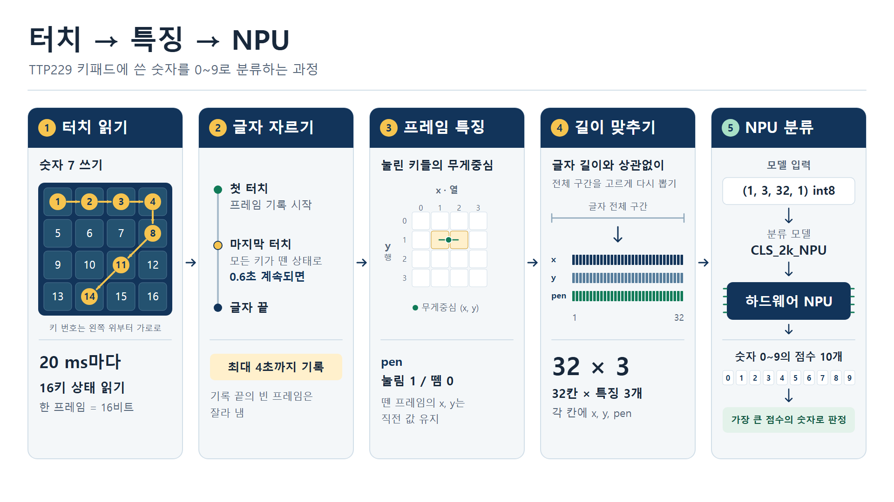
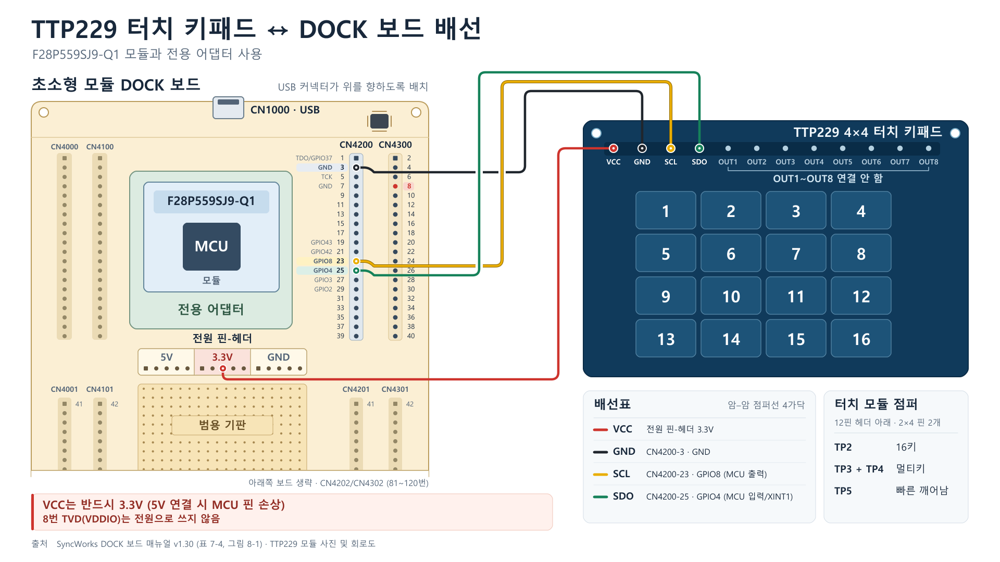

# DOCK_F28P55x_TouchDigit_EdgeAI

TTP229 4x4 터치 키패드에 손가락으로 쓴 **숫자 0~9를 Edge AI로 인식**하는 예제입니다. 데이터 수집, 학습, 보드의 하드웨어 NPU 추론까지 순서대로 따라 할 수 있도록 두 프로젝트를 한 저장소에 담았습니다. 초소형 모듈 DOCK 보드 + TMS320F28P559SJ9-Q1 모듈 기준이며, 핀 번호가 같은 TMS320F28X EVM V2(B Side)에서도 같은 코드를 씁니다.

**3줄 요약**
- `8_TouchDigitLogger`가 키패드에 쓴 글자를 32칸 x 3열(x, y, pen) 특징으로 바꿔 Edge AI Studio 학습용 CSV로 저장합니다.
- 학습한 분류 모델(CLS_2k_NPU)을 `9_TouchDigitClassify_NPU`가 F28P55x의 **하드웨어 NPU**로 실행해 숫자를 판정합니다. 추론 시간은 약 300us입니다.
- 직접 쓴 300글자(숫자당 30)로 학습한 모델이 보드 채점 30/30이었습니다. 같은 사람, 같은 환경의 데이터라서 다른 사람이나 다른 쓰는 방식에서의 정확도는 확인하지 않았습니다.

## 1. 저장소 구성

```
DOCK_F28P55x_TouchDigit_EdgeAI/
├── README.md                          이 문서
├── 8_TouchDigitLogger/                ① 글자 수집 펌웨어 + 수집 스크립트 + 데이터 도구
│   ├── README.md                      배선·점퍼·수집·학습 설정까지 전체 수행 방법
│   └── docs/images/                   배선도, 특징 계산 흐름도
└── 9_TouchDigitClassify_NPU/          ② 학습한 모델을 NPU로 실행해 숫자 판정 + 채점
    ├── README.md                      변수, "판정 안 함" 기준, 모델 교체 방법
    └── model/                         Edge AI Studio 결과 (mod.a 등 4개 파일)
```

각 폴더는 CCS에서 `CCS/*.projectspec`을 Import해 바로 빌드할 수 있습니다.

## 2. 진행 순서



| 단계 | 할 일 | 자세히 |
|---|---|---|
| 1 | 터치패드 점퍼를 설정하고 4가닥을 배선합니다. | [8_ README 3~5절](8_TouchDigitLogger/README.md) |
| 2 | `8_TouchDigitLogger`를 빌드해 올리고 배선·점퍼를 확인합니다. | [8_ README 6~7절](8_TouchDigitLogger/README.md) |
| 3 | CCS Scripting Console에서 `collect_touch.js`로 숫자를 씁니다. 숫자마다 30~50글자를 권합니다. | [8_ README 8절](8_TouchDigitLogger/README.md) |
| 4 | `check_dataset.py`로 zip을 만들어 Edge AI Studio에서 학습합니다. | [8_ README 9절](8_TouchDigitLogger/README.md) |
| 5 | 결과 파일 4개를 `9_TouchDigitClassify_NPU/model/`에 덮어쓰고 빌드합니다. | [9_ README](9_TouchDigitClassify_NPU/README.md) |
| 6 | 숫자를 쓰면 `predDigit`에 판정이 나옵니다. `test_touch.js`로 30글자를 채점합니다. | [9_ README](9_TouchDigitClassify_NPU/README.md) |

`9_TouchDigitClassify_NPU/model/`에는 이미 학습한 모델이 들어 있어서, 수집·학습을 건너뛰고 5~6단계만 해도 동작을 볼 수 있습니다. 다만 그 모델은 특정 사람의 글씨로 학습했으므로 본인 글씨로 다시 학습하는 편이 정확합니다.

## 3. 배선 요약



| 터치패드 | DOCK 보드 | EVM V2 |
|---|---|---|
| VCC | 전원 핀-헤더 **3.3V** | 3.3V 단자 |
| GND | CN4200 실크 3번 | B Side 3번 |
| SCL | CN4200 실크 23번 (GPIO8, 출력) | B Side 23번 |
| SDO | CN4200 실크 25번 (GPIO4, 입력, XINT1) | B Side 25번 |

**VCC는 반드시 3.3V입니다.** 5V에 꽂으면 SDO가 5V로 나와 MCU 핀이 상합니다. 터치패드 점퍼(TP2, TP3+TP4, TP5) 위치와 확인 방법은 8_ README에 있습니다.

## 4. 결과와 확인 상태

| 항목 | 값 |
|---|---|
| 모델 | CLS_2k_NPU (Variables 3, Frame 32, int8, `TVMGEN_DEFAULT_TI_NPU`) |
| 학습 데이터 | 직접 쓴 300글자 (숫자당 30), Batch 16, Epochs 60 |
| Studio 시험 정확도 | 100% (30글자) |
| 보드 채점 | 30/30, 최소 margin 15, 추론 300.2us (`9_TouchDigitClassify_NPU/results/test_r01.csv`) |

- **확인함 (2026-11-23):** DOCK 보드 + F28P559SJ9-Q1 + TTP229 실제 연결, 수집 → 학습 → 보드 채점.
- **확인 전:**
  - 9_ 펌웨어 v1.20의 "판정 안 함"(키 하나만 눌렀을 때 `predDigit = -1`)은 빌드와 PC 모의 입력으로만 확인했고 보드에서는 실행하지 않았습니다. 위 30/30은 v1.20 이전 펌웨어 결과입니다.
  - EVM V2 + F28P55x 모듈 조합은 핀 번호가 같다는 근거로 같은 코드를 쓰지만, 이 조합에서의 실행은 확인하지 않았습니다.
  - 터치패드 점퍼 위치는 회로도와 1번 핀 위치로 추정한 값입니다.
- 학습에 쓴 300글자 데이터셋은 저장소에 포함하지 않았습니다.

## 5. 개발 환경

CCS v21, CGT 25.11.1, C2000Ware 26.02, Edge AI Studio 1.8.0. 대상 디바이스는 TMS320F28P559SJ9-Q1(F28P55x, NPU 내장)입니다.
